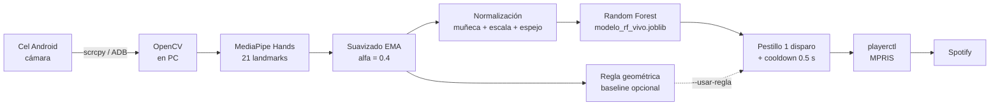
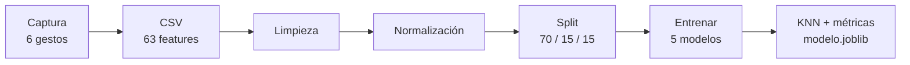
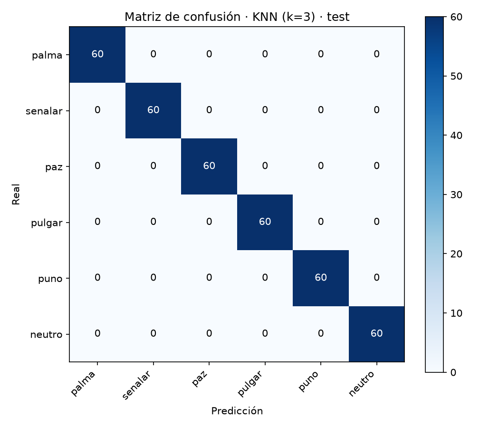
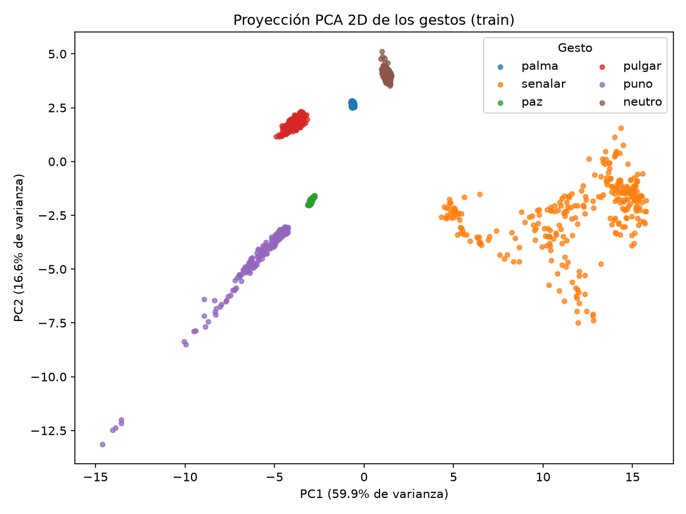

Problema y objetivo
===

<!-- new_lines: 2 -->
<!-- list_item_newlines: 1 -->

**Problema:** controlar la música sin tocar el equipo.

**Objetivo:** reconocer gestos de mano con un modelo de ML clásico y usarlos para controlar Spotify en tiempo real.

- Dataset propio: **2,400 muestras**, 400 por clase
- Pipeline completo: captura → limpieza → modelo → métricas → demo
- Modelo académico: **KNN (k=3)**; modelo del demo: **Random Forest adaptado en vivo**

<!-- end_slide -->

Pipeline de inferencia (demo)
===

<!-- new_lines: 2 -->
<!-- alignment: center -->



<!-- end_slide -->

Pipeline de datos y entrenamiento
===

<!-- new_lines: 2 -->
<!-- alignment: center -->



En el demo: **689 cuadros** (570 base + 119 de corrección) → **Random Forest** (`modelo_rf_vivo.joblib`) con las mismas 64 features geométricas.

<!-- end_slide -->

Datos
===

<!-- new_lines: 2 -->
<!-- list_item_newlines: 1 -->

- **Fuente:** cámara web / celular vía scrcpy o ADB + MediaPipe Hands
- **Features:** 63 (21 landmarks × x, y, z)
- **Clases (6):** palma, señalar, paz, pulgar, puño, neutro
- **Tamaño:** 2,400 muestras → **400 por clase**
- **Sesiones:** 6 grabaciones continuas de ~13 s a ~30 FPS
- **Calidad:** 0 nulos, 0 no finitos, 0 duplicados exactos
- **Partición:** 1,680 train / 360 val / 360 test

<!-- end_slide -->

Gestos y acciones
===

<!-- new_lines: 2 -->
<!-- alignment: center -->

| Gesto         | Acción         | Comando                     |
|:-------------:|:--------------:|:----------------------------|
| Palma         | Play / Pausa   | `playerctl play-pause`      |
| Señalar       | Siguiente      | `playerctl next`            |
| Paz           | Anterior       | `playerctl previous`        |
| Pulgar arriba | Subir volumen  | `playerctl volume 0.1+`     |
| Puño          | Bajar volumen  | `playerctl volume 0.1-`     |
| Neutro        | Nada           | —                           |

<!-- end_slide -->

Limpieza y preprocesamiento
===

<!-- new_lines: 1 -->
<!-- list_item_newlines: 1 -->

1. Quitar frames sin mano detectada
2. Quitar nulos, infinitos, vectores degenerados y duplicados
3. Traslación: restar coordenadas de la muñeca (landmark 0)
4. Escala: dividir entre distancia muñeca → nudillo medio (landmark 9)
5. Espejar eje x en mano izquierda
6. Split estratificado 70 / 15 / 15 con `random_state=42`

<!-- new_lines: 1 -->

> "Sin normalizar, el modelo aprende dónde está la mano, no su forma."

<!-- end_slide -->

Modelos y protocolo
===

<!-- new_lines: 2 -->
<!-- list_item_newlines: 1 -->

- **Modelos:** SVM RBF, SVM lineal, KNN, Random Forest y MLP
- **Escalado:** `StandardScaler` para SVM, KNN y MLP
- **Selección:** validación; `test` se reserva para la evaluación final
- **KNN:** se probaron `k = 3, 5, 7, 9, 11`; se eligió `k = 3`
- **Métricas:** Accuracy, F1 macro, latencia y matriz de confusión
- **PCA 2D:** solo para visualizar los clusters de gestos

<!-- end_slide -->

Resultados en validación
===

<!-- new_lines: 1 -->
<!-- alignment: center -->

| Modelo | Accuracy | F1 macro | Latencia / muestra |
|:---|---:|---:|---:|
| SVM RBF | 1.0000 | 1.0000 | 0.592 ms |
| **SVM lineal** | **1.0000** | **1.0000** | **0.536 ms** |
| Random Forest | 1.0000 | 1.0000 | 34.269 ms |
| MLP | 1.0000 | 1.0000 | 0.998 ms |
| KNN (`k=3`) | 1.0000 | 1.0000 | 2.265 ms |

<!-- new_lines: 1 -->

Los cinco modelos separan perfectamente el corpus de validación. SVM lineal queda como mejor modelo por F1 y latencia.

<!-- end_slide -->

Modelo académico del dataset: KNN
===

<!-- new_lines: 2 -->
<!-- list_item_newlines: 1 -->

- **Modelo del dataset:** KNN (`k=3`) por simplicidad y bajo costo computacional
- **Hiperparámetro:** `k = 3`, elegido sobre validación
- **Entrenamiento final:** train + validación → 2,040 muestras
- **Evaluación:** una sola pasada sobre 360 muestras de prueba
- **El demo no usa este modelo:** usa un Random Forest adaptado a la cámara real

<!-- new_lines: 1 -->

| Métrica en prueba | Valor |
|:---|---:|
| Accuracy | **1.0000** |
| F1 macro | **1.0000** |
| Latencia media | **0.907 ms** |

<!-- end_slide -->

Matriz de confusión (KNN en prueba)
===

<!-- new_lines: 1 -->
<!-- alignment: center -->



Las 360 muestras de prueba fueron clasificadas correctamente.

<!-- end_slide -->

PCA 2D
===

<!-- new_lines: 1 -->
<!-- alignment: center -->



Se observan seis agrupaciones separadas. Es una visualización del corpus, no una prueba de generalización.

<!-- end_slide -->

La prueba en vivo cambió el diagnóstico
===

<!-- new_lines: 2 -->
<!-- list_item_newlines: 1 -->

- Con otra mano y otro ángulo, el KNN baseline acertó **18.5%** (15/81)
- Se reentrenó un SVM con **64 features geométricas**: 98.9% offline
- En vivo, ese SVM cayó a **20%** y colapsó casi todo a `puno`
- Causa: **cambio de dominio**, no un umbral mal elegido
- Dato clave: en `palma` las cuatro rectitudes son ≈ 1.00, pero el KNN predice `puno`
- MediaPipe reportó `handedness=Right` de forma poco fiable

<!-- new_lines: 1 -->

> El F1 alto sobre el corpus no era evidencia de robustez.

<!-- end_slide -->

Regla geométrica: baseline interpretable
===

<!-- new_lines: 1 -->
<!-- list_item_newlines: 1 -->

- **Suavizado EMA** (`alfa=0.4`) sobre los 21 landmarks: menos temblor, mismo gesto
- **Regla geométrica**: rectitud de dedos + ángulos + distancias normalizadas por la palma
- Invariante a traslación, escala, lateralidad y rotación
- `paz` usa el ratio anular/medio: acepta el anular semi-extendido de la mano izquierda
- **Pero no generaliza:** al probar dos manos y seis clases bajó a **76.8%**

<!-- new_lines: 1 -->

| Evaluación | Exactitud |
|:---|---:|
| SVM geométrico, split temporal | 0.9889 |
| SVM geométrico, en vivo | 0.2000 |
| Regla geométrica, 190 cuadros (calibración) | 1.0000 |
| Regla geométrica, dataset | 0.9433 |
| Regla geométrica, 570 cuadros, 2 manos, 6 clases | 0.7684 |

<!-- end_slide -->

Modelo final: Random Forest adaptado al dominio
===

<!-- new_lines: 2 -->
<!-- list_item_newlines: 1 -->

- **570 cuadros base** con ambas manos y seis clases
- **119 cuadros de corrección** de pulgar y puño izquierdos
- Pipeline: 64 features geométricas → `StandardScaler` → **Random Forest**
- `n_estimators=100`, `max_depth=6`, `min_samples_leaf=3`, `n_jobs=1`
- Suavizado EMA idéntico al del demo; sin reglas `if/else` decidiendo
- `--usar-regla` activa la regla como baseline; `--mostrar-ml` muestra ambas

<!-- new_lines: 1 -->

| Evaluación del Random Forest | Exactitud |
|:---|---:|
| Validación entre manos del modelo base, izquierda / derecha | 0.9302 / 0.9608 |
| Solo acciones del modelo base, izquierda / derecha | 0.9962 / 0.9507 |
| Validación temporal 70/30 por bloque (689) | 0.9858 |
| Sesión independiente de 190 cuadros | 1.0000 |
| Holdout del 30% de la corrección (36) | 0.8056 |
| Dataset académico (otro dominio) | 0.3250 |
| Latencia por muestra | 7.75 ms |

<!-- end_slide -->

Validación en vivo del modelo final
===

<!-- new_lines: 2 -->
<!-- list_item_newlines: 1 -->

- **541 cuadros** etiquetados con ambas manos; validación con el filtro académico de 5 cuadros
- **10/10 bloques de acción** dispararon el gesto correcto
- **93.4%** por cuadro en acciones; **86.3%** global incluyendo `neutro`
- Flujo con confirmación (versión previa): **5/5 acciones** correctas en `--dry-run`
- `neutro` izquierdo: 42/51; 9 cuadros se ven como `palma` (pose casi idéntica)
- El pestillo final impide repetir la acción mientras el gesto se mantiene

<!-- end_slide -->

Filtro temporal y demo
===

<!-- new_lines: 2 -->
<!-- list_item_newlines: 1 -->

- El gesto se ejecuta en el **primer cuadro** predicho, sin confirmación manual
- **Un disparo por presentación:** el pestillo se rearma al bajar la mano (3 cuadros) o al cambiar de gesto (5 cuadros)
- **Cooldown** de 0.5 s entre acciones
- `neutro`, ausencia de mano y etiquetas desconocidas nunca disparan
- **Suavizado EMA** de landmarks y **modelo Random Forest** antes del pestillo
- **62 tests** pasan, incluidos el modelo en vivo, su latencia y el pestillo
- HUD: gesto, cooldown y FPS
- Verificación automática: `python scripts/demo.py --dry-run --timeout 5`
- Uso normal: `python scripts/demo.py`, sin Enter

<!-- end_slide -->

Recorrido por el código (1/3)
===

<!-- new_lines: 2 -->
<!-- list_item_newlines: 1 -->

- `scripts/vision.py` — MediaPipe en modo VIDEO con seguimiento entre cuadros
- `scripts/utils.py` — normalización 63D: muñeca, escala y espejo
- `scripts/geometria.py` — 64 features geométricas y suavizado EMA

```python
timestamp_ms = max(int(time.monotonic() * 1000), _ULTIMO_TIMESTAMP_MS + 1)
_ULTIMO_TIMESTAMP_MS = timestamp_ms
resultado = detector.detect_for_video(mp_img, timestamp_ms)
```

<!-- end_slide -->

Recorrido por el código (2/3)
===

<!-- new_lines: 2 -->
<!-- list_item_newlines: 1 -->

- `scripts/demo.py` — predicción → pestillo → filtro → `playerctl`
- `PestilloGesto` — una acción por presentación, sin Enter
- Se rearma con 3 cuadros neutros o 5 cuadros de otro gesto

```python
if pestillo.actualizar(gesto):
    disparo = filtro.actualizar(gesto, ahora)
else:
    filtro.reiniciar()
    disparo = None

if disparo is not None:
    ejecutor.submit(despachar_gesto, disparo)
    pestillo.bloquear(disparo)
```

<!-- end_slide -->

Recorrido por el código (3/3)
===

<!-- new_lines: 2 -->
<!-- list_item_newlines: 1 -->

- `scripts/entrenar_vivo.py` reproduce el Random Forest de 689 cuadros
- `data/vivo/` — base, corrección izquierda y sesión independiente
- `tests/` — modelo, latencia, pestillo y replay de 190 cuadros

```bash
python scripts/entrenar_vivo.py
pytest tests/ -q
python scripts/demo.py --dry-run --timeout 5
```

<!-- end_slide -->

Limitaciones
===

<!-- new_lines: 2 -->
<!-- list_item_newlines: 1 -->

- Cada clase proviene de **una sola sesión continua** de ~13 s
- Cuadros consecutivos casi idénticos → el split aleatorio **infla las métricas**
- Cada clase del dataset se grabó con **una sola mano** (3 izquierdas, 3 derechas)
- El F1 = 1.0 es una **cota optimista**, no generalización a usuarios nuevos
- Prueba en vivo con otra mano/ángulo: **18.5%** con KNN y **20%** con el SVM geométrico
- La regla geométrica llegó a **76.8%** con dos manos y seis clases: los umbrales se peleaban
- El Random Forest adaptado alcanza **93–96%** entre manos, pero está calibrado para un usuario y una cámara
- La validación en vivo detectó fallos en pulgar/puño izquierdo; se corrigieron con 119 cuadros (holdout 80.6%)
- `neutro` izquierdo se confunde con `palma` (21/53); `señalar` derecho tuvo solo 14 cuadros
- Trabajo futuro: más sesiones y usuarios, split por sesión/persona y validación out-of-distribution

<!-- end_slide -->

Entregables
===

<!-- new_lines: 2 -->
<!-- list_item_newlines: 1 -->

- `data/dataset.csv` — 2,400 landmarks etiquetados
- `notebooks/analisis.ipynb` — EDA, split, entrenamiento y evaluación
- `scripts/capturar.py` — captura interactiva del dataset
- `scripts/geometria.py` — 64 features geométricas, suavizado EMA y regla baseline
- `scripts/entrenar_geometrico.py` — SVM geométrico y métricas de robustez
- `scripts/demo.py` — inferencia con Random Forest en tiempo real y `playerctl`
- `scripts/entrenar_vivo.py` — reproduce el modelo y las métricas de la demo
- `data/vivo/` — 689 cuadros de entrenamiento y 190 de validación independiente
- `tests/test_modelo_vivo.py` — carga, clases válidas y latencia del modelo de la demo
- `models/modelo.joblib` — pipeline KNN serializado (modelo académico)
- `models/modelo_rf_vivo.joblib` — Random Forest adaptado a la cámara real (demo)
- `models/modelo_geom.joblib` — SVM geométrico experimental
- `models/metricas.json`, `models/metricas_geom.json`, `models/metricas_rf_vivo.json` — métricas y configuración
- `reporte/reporte.md` — reporte académico con figuras

<!-- end_slide -->

Conclusiones
===

<!-- new_lines: 2 -->
<!-- list_item_newlines: 1 -->

- Pipeline reproducible de captura, preprocesamiento, ML y demo en CPU
- Dataset balanceado: 2,400 muestras, 400 por clase, 16.67% por clase
- KNN (`k=3`) obtiene F1 macro 1.0 en prueba y 0.907 ms de latencia (modelo académico)
- La prueba en vivo expuso cambio de dominio: 18.5% con el modelo base
- La regla geométrica no generalizó: **76.8%** con dos manos y seis clases
- Random Forest: **93–96%** entre manos (modelo base), **100%** en sesión independiente, **7.7 ms**
- Corrección en vivo: 119 cuadros nuevos elevan pulgar/puño izquierdo de 69.4% a 80.6% en holdout
- El demo decide con el modelo entrenado; `--usar-regla` deja la regla como baseline
- Pestillo de un disparo por presentación + cooldown de 0.5 s evita repeticiones
- Las métricas perfectas y el 100% en calibración deben presentarse con sus limitaciones

<!-- end_slide -->

<!-- jump_to_middle -->
<!-- alignment: center -->

¿Preguntas?
===
