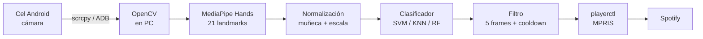
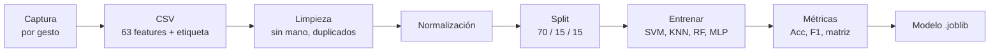

Problema y objetivo
===

<!-- new_lines: 2 -->
<!-- list_item_newlines: 1 -->

**Problema:** controlar la música sin tocar el equipo.

**Objetivo:** reconocer gestos de mano con un modelo de ML clásico y usarlos para controlar Spotify en tiempo real.

- Dataset propio (no descargado)
- Pipeline completo: captura → limpieza → modelo → métricas → demo

<!-- end_slide -->

Pipeline de inferencia (demo)
===

<!-- new_lines: 2 -->
<!-- alignment: center -->

<!-- end_slide -->

Pipeline de datos y entrenamiento
===

<!-- new_lines: 2 -->
<!-- alignment: center -->

<!-- end_slide -->

Datos
===

<!-- new_lines: 2 -->
<!-- list_item_newlines: 1 -->

- **Fuente:** cámara del cel vía scrcpy / ADB + MediaPipe Hands
- **Features:** 63 (21 landmarks × x, y, z)
- **Clases (6):** palma, señalar, pulgar, puño, paz, neutro
- **Tamaño:** ~300–500 frames por clase
- **Variación:** distancia, iluminación, mano izquierda / derecha

<!-- end_slide -->

Gestos y acciones
===

<!-- new_lines: 2 -->
<!-- alignment: center -->

| Gesto         | Acción         | Comando                     |
|:-------------:|:--------------:|:----------------------------|
| Palma         | Play / Pausa   | `playerctl play-pause`      |
| Señalar       | Siguiente      | `playerctl next`            |
| Paz           | Anterior       | `playerctl previous`        |
| Pulgar arriba | Subir volumen  | `playerctl volume 0.1+`     |
| Puño          | Bajar volumen  | `playerctl volume 0.1-`     |
| Neutro        | Nada           | —                           |

<!-- end_slide -->

Limpieza y preprocesamiento
===

<!-- new_lines: 1 -->
<!-- list_item_newlines: 1 -->

1. Quitar frames sin mano detectada
2. Quitar duplicados y nulos
3. Traslación: restar coordenadas de la muñeca (landmark 0)
4. Escala: dividir entre distancia muñeca → nudillo medio (landmark 9)
5. Espejar eje x en mano izquierda
6. Balancear clases

<!-- new_lines: 1 -->

> "Sin normalizar, el modelo aprende dónde está la mano, no su forma."

<!-- end_slide -->

Modelos y métricas
===

<!-- new_lines: 2 -->
<!-- list_item_newlines: 1 -->

- **Modelos:** SVM, KNN, Random Forest (extra: MLP)
- **Split:** train / val / test  →  70 / 15 / 15
- **Métricas:** accuracy, F1 por clase, matriz de confusión
- Comparación entre modelos
- PCA 2D solo para visualizar clusters

<!-- end_slide -->

Demo en vivo
===

<!-- new_lines: 2 -->
<!-- list_item_newlines: 1 -->

- Inferencia en CPU (ThinkPad T480, ~20–30 fps)
- Acción activada solo si el gesto se repite **5 frames seguidos**
- **Cooldown** de 1 s entre acciones consecutivas
- Clase **neutro** para ignorar movimientos normales de la mano

<!-- end_slide -->

Entregables
===

<!-- new_lines: 2 -->
<!-- list_item_newlines: 1 -->

- `dataset.csv` — landmarks etiquetados
- `notebook_analisis.ipynb` — EDA, entrenamiento y métricas
- `captura.py` — script de captura de datos
- `demo.py` — script de inferencia en tiempo real
- Reporte con métricas y comparación de modelos

<!-- end_slide -->

<!-- jump_to_middle -->
<!-- alignment: center -->

¿Preguntas?
===
