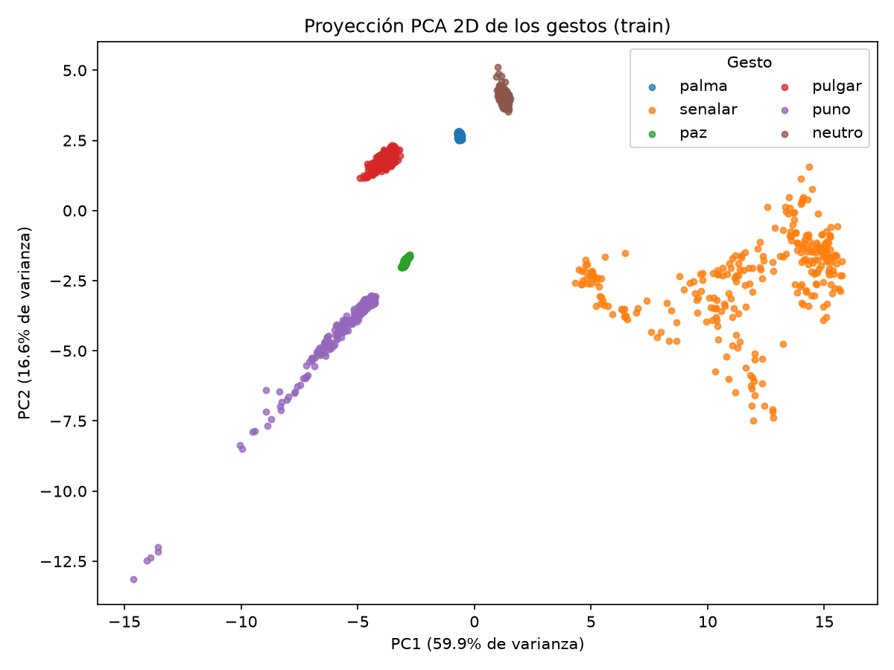
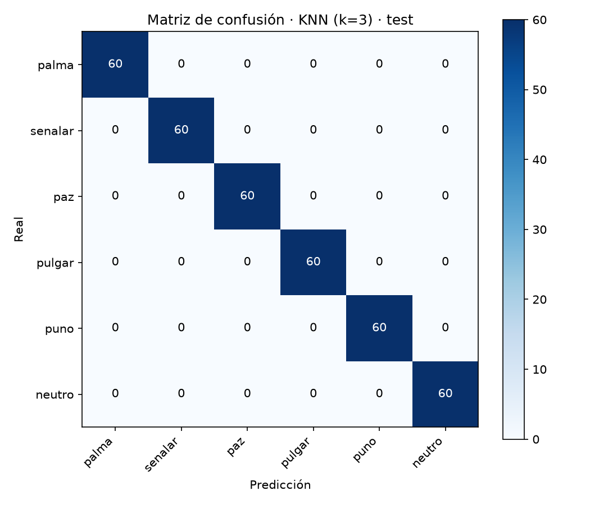

# Control Multimedia por Gestos de Mano mediante Landmarks 3D y ML Clásico

**Proyecto:** Control de Spotify por gestos en tiempo real
**Curso:** Minería de Datos · ITIID-71
**Fecha:** 15 de noviembre de 2026
**Repositorio:** `Proyecto 2do Parc`

---

## Resumen

Se desarrolló un sistema de visión por computadora que reconoce seis gestos estáticos de la mano y los traduce en comandos multimedia para Spotify sobre Linux. La entrada son 21 landmarks tridimensionales extraídos con MediaPipe Hands; cada gesto se representa como un vector de 63 características normalizadas geométricamente. Se compararon cinco clasificadores clásicos —SVM con kernel RBF, SVM lineal, KNN, Random Forest y MLP— sobre un dataset propio de 2,400 muestras balanceadas. Todos alcanzaron Accuracy y F1 macro de 1.0 en validación y prueba; para el modelo académico se seleccionó KNN (`k=3`), con 0.91 ms de latencia. La prueba en vivo expuso un cambio de dominio: el modelo del dataset cayó a 18.5% con otra mano y otra cámara. Para la demo se capturaron 570 cuadros con ambas manos, se entrenó un Random Forest sobre las mismas 64 características geométricas y se añadieron 119 cuadros de corrección para la mano izquierda. El modelo base generalizó entre manos con **93.0%** y **96.1%**; el modelo final alcanzó **100%** en una sesión independiente de 190 cuadros y **7.7 ms** por muestra. Ese modelo entrenado —no una regla escrita a mano— es el que decide la acción. El demo ejecuta el gesto en el primer cuadro predicho, con un pestillo que evita repeticiones mientras la mano mantiene la pose y un cooldown de 0.5 s; las acciones se despachan con `playerctl` sobre MPRIS de forma no bloqueante.

**Palabras clave:** MediaPipe Hands, landmarks 3D, clasificación multiclase, Random Forest, cambio de dominio, MPRIS, interacción sin contacto.

---

## 1. Introducción

### 1.1 Problema

Controlar la reproducción musical sin tocar el teclado ni el ratón es útil en escenarios donde las manos están ocupadas, el equipo está a distancia o se busca una interacción más natural. Una cámara y un modelo de bajo costo computacional pueden sustituir los controles físicos por gestos.

### 1.2 Objetivo

Construir un pipeline completo que:

1. Capture landmarks de la mano desde una cámara.
2. Normalice la geometría para ser invariante a posición, escala y lateralidad.
3. Entrene y compare clasificadores clásicos de Machine Learning.
4. Reconozca gestos en tiempo real sobre CPU.
5. Controle Spotify mediante comandos MPRIS, con filtrado temporal para evitar falsos positivos.

### 1.3 Alcance

El sistema reconoce **gestos estáticos** de **una sola mano**. Quedan fuera del alcance los gestos dinámicos, la interacción bimanual y el entrenamiento de redes profundas sobre píxeles.

---

## 2. Metodología

### 2.1 Adquisición del dataset

El dataset fue generado íntegramente por el equipo con `scripts/capturar.py`. Por cada gesto se abrió la cámara, se detectó la mano con MediaPipe y se almacenaron las 63 coordenadas normalizadas junto con etiqueta, lateralidad, identificador de sesión y timestamp.

| Clase | Muestras | Mano registrada | Sesión |
|:---|---:|:---:|:---:|
| `palma` | 400 | Izquierda | 1 |
| `senalar` | 400 | Izquierda | 1 |
| `paz` | 400 | Derecha | 1 |
| `pulgar` | 400 | Derecha | 1 |
| `puno` | 400 | Derecha | 1 |
| `neutro` | 400 | Izquierda | 1 |
| **Total** | **2,400** | — | **6** |

Características del corpus:

- 67 columnas: 63 features (`x0..x20`, `y0..y20`, `z0..z20`) y 4 metadatos (`label`, `handedness`, `session_id`, `timestamp`).
- 0 valores nulos, 0 valores no finitos y 0 duplicados exactos de features.
- Cada sesión duró aproximadamente 13.3 s a ~30 FPS, por lo que las 400 muestras de una clase son cuadros consecutivos de una misma grabación.
- Cada clase se grabó con una sola mano; el espejado de lateralidad en el preprocesamiento canonicaliza ambas manos.

### 2.2 Preprocesamiento

Para cada conjunto de 21 puntos $P \in \mathbb{R}^{21 \times 3}$:

1. **Traslación:** $P_i' = P_i - P_0$, donde $P_0$ es la muñeca (landmark 0).
2. **Escala:** $P_i'' = P_i' / \lVert P_9' \rVert_2$, usando el nudillo del dedo medio (landmark 9) como referencia métrica.
3. **Lateralidad:** si `handedness == "Left"`, se invierte el eje $x$ para compartir el mismo espacio de representación que la mano derecha.
4. **Vectorización:** $(x_0,\dots,x_{20}, y_0,\dots,y_{20}, z_0,\dots,z_{20}) \in \mathbb{R}^{63}$.

La limpieza descartó filas con valores no finitos, vectores degenerados, coordenadas con magnitud superior a 10, etiquetas fuera de las seis clases, lateralidades inválidas y duplicados exactos. **El dataset actual no perdió ninguna fila.**

La partición fue estratificada **70 / 15 / 15** con `random_state=42`:

| Partición | Muestras | Por clase |
|:---|---:|---:|
| Entrenamiento | 1,680 | 280 |
| Validación | 360 | 60 |
| Prueba | 360 | 60 |

### 2.3 Modelos y protocolo de evaluación

Se evaluaron cinco candidatos:

| Modelo | Configuración |
|:---|:---|
| SVM RBF | `StandardScaler` + `SVC(kernel="rbf", C=10, gamma="scale")` |
| SVM lineal | `StandardScaler` + `SVC(kernel="linear", C=1)` |
| KNN | `StandardScaler` + `KNeighborsClassifier(k)` con $k \in \{3,5,7,9,11\}$ |
| Random Forest | 300 árboles |
| MLP | `StandardScaler` + dos capas ocultas (128, 64), `early_stopping=True` |

El conjunto de **validación** se usó para comparar modelos y elegir $k$. El conjunto de **prueba** se reservó hasta la evaluación final del modelo seleccionado. Todas las semillas se fijaron en 42.

### 2.4 Filtro temporal

Para evitar que una predicción aislada dispare un comando, se implementó una máquina de estados (`scripts/filtro.py`). En la demo se prioriza la respuesta inmediata:

- El demo usa `frames_confirmacion=1`: el gesto se ejecuta en el primer cuadro predicho, sin Enter.
- Un pestillo (`PestilloGesto`) impide repetir la acción mientras el gesto se mantiene; se rearma al bajar la mano (3 cuadros) o al sostener otro gesto durante 5 cuadros.
- El demo aplica un cooldown de **0.5 s**; el módulo conserva **1.0 s** por defecto para no alterar sus tests.
- El filtro académico de **5 cuadros consecutivos** sigue disponible en `FiltroDisparo` y se usó en la validación por bloques.
- Las clases `neutro`, la ausencia de mano y las etiquetas desconocidas nunca disparan.
- El estado se expone como progreso (0–1) y como cooldown restante para el HUD.

### 2.5 Integración multimedia

En Linux, cada gesto confirmado se traduce a una acción y se despacha con `playerctl`:

| Gesto | Acción | Comando |
|:---|:---|:---|
| `palma` | Play / Pausa | `playerctl play-pause` |
| `senalar` | Siguiente | `playerctl next` |
| `paz` | Anterior | `playerctl previous` |
| `pulgar` | Volumen +10% | `playerctl volume 0.1+` |
| `puno` | Volumen −10% | `playerctl volume 0.1-` |
| `neutro` | Sin acción | — |

El envío se ejecuta en un hilo trabajador para no bloquear el bucle de video. En Windows, la capa de abstracción usa `keybd_event` de la Win32 API.

---

## 3. Resultados

### 3.1 Comparación en validación

| Modelo | Accuracy | F1 macro | Latencia por muestra | Entrenamiento |
|:---|---:|---:|---:|---:|
| SVM RBF | 1.0000 | 1.0000 | 0.592 ms | 0.039 s |
| SVM lineal | 1.0000 | 1.0000 | **0.536 ms** | 0.008 s |
| Random Forest | 1.0000 | 1.0000 | 34.269 ms | 1.365 s |
| MLP | 1.0000 | 1.0000 | 0.998 ms | 0.198 s |
| KNN (`k=3`) | 1.0000 | 1.0000 | 2.265 ms | 0.362 s |

Los cinco modelos separan perfectamente el conjunto de validación. SVM lineal queda como `mejor_modelo` por F1 y latencia, mientras que Random Forest presenta la mayor latencia por muestra, aunque sigue por debajo del límite de 100 ms por cuadro.

### 3.2 Proyección PCA 2D



La proyección sobre las dos primeras componentes muestra seis agrupaciones bien separadas. Esto es consistente con gestos estáticos y un dataset capturado en condiciones controladas; no debe interpretarse como evidencia de generalización a usuarios nuevos.

### 3.3 Modelo académico del dataset: KNN

Para el corpus académico se eligió **KNN** (`k=3`) por su simplicidad y su bajo costo computacional. Se probaron $k \in \{3,5,7,9,11\}$ y se conservó `k=3` (mejor F1 en validación; ante empate se mantuvo el menor $k$). El modelo se reentrenó con **train + validación** (2,040 muestras) y se evaluó una sola vez sobre prueba. Este modelo se conserva como referencia del dominio original; **el demo no lo usa**.

| Métrica en prueba | Valor |
|:---|---:|
| Accuracy | 1.0000 |
| F1 macro | 1.0000 |
| Latencia media por muestra | 0.907 ms |
| Muestras de prueba | 360 |



La matriz de confusión es diagonal: las 360 muestras de prueba fueron clasificadas correctamente. El modelo serializado se encuentra en `models/modelo.joblib` y sus metadatos en `models/metadata.json`.

### 3.4 Filtro temporal

La suite `tests/test_filtro.py` verifica 14 casos:

- No dispara con 4 cuadros; dispara exactamente en el 5.º.
- Un cambio de gesto reinicia el conteo.
- `neutro`, ausencia de mano y etiquetas desconocidas nunca disparan.
- El cooldown bloquea ráfagas durante 1.0 s y se libera exactamente al cumplirse el intervalo.
- `cooldown_restante()` decrece hasta cero para alimentar el HUD.
- Los parámetros inválidos lanzan `ValueError`.

### 3.5 Demo en tiempo real

`scripts/demo.py` integra MediaPipe, el Random Forest adaptado (`models/modelo_rf_vivo.joblib`), el pestillo anti-repetición, el cooldown y el HUD. La regla geométrica se activa con `--usar-regla` como baseline. La verificación automatizada se ejecuta con:

```bash
python scripts/demo.py --dry-run --timeout 5
```

El bucle abre la cámara, detecta la mano, suaviza los landmarks, muestra gesto, cooldown restante y FPS. El gesto se ejecuta en el primer cuadro predicho; el pestillo impide repetir la acción mientras la pose se mantiene y se rearma al bajar la mano o cambiar de gesto.

La prueba en vivo con Spotify confirmó que el despacho MPRIS funciona: `palma` pausó y reanudó, `senalar` cambió de canción y `puno` ajustó el volumen. También expuso que el modelo entrenado con una sola mano por clase no generaliza a otras manos o ángulos: en una prueba guiada de 12 segmentos el acierto fue de 18.5%, con confusión entre `palma`, `paz`, `pulgar` y `puno`. Para evitar comandos accidentales durante el demo se añadieron inicialmente la autorización por Enter y un cooldown configurable; la versión final sustituyó el Enter por un pestillo que dispara una sola vez por presentación. El aumento de datos con espejado y rotaciones que recuperó el 100% en pruebas sintéticas **no** se sostuvo en vivo: el SVM geométrico cayó a 20%, como se documenta en la sección 3.6.

### 3.6 Modelo entrenado en vivo y suavizado

El 18.5% en vivo no se debía solo al umbral del filtro, sino a un **cambio de dominio**: los landmarks de otra mano y otra cámara no se parecen a los del corpus. Para medirlo se capturaron 190 cuadros etiquetados en una sesión independiente (38 por clase). Sobre esos datos, el KNN baseline se mantuvo en 18.5% y un SVM RBF reentrenado con 64 características geométricas —rectitud de dedos, ángulos articulares y distancias normalizadas por la palma— cayó a 20%, prediciendo `puno` casi siempre, pese a haber obtenido 98.9% en un split temporal del dataset.

El análisis mostró que la geometría sí separa los gestos. En `palma`, las cuatro rectitudes en vivo son ≈ 1.00, pero el KNN predice `puno`; en `senalar`, el índice es ≈ 1.00 y el medio ≈ 0.65. Con esos valores se construyó una regla determinista (tabla 2.4 del diseño) y se añadió un suavizado EMA (`alfa=0.4`) para el temblor de los nodos.

| Evaluación | Exactitud |
|:---|---:|
| SVM geométrico, split temporal del dataset (720 muestras) | 0.9889 |
| SVM geométrico, 190 cuadros en vivo | 0.2000 |
| Regla geométrica, 190 cuadros en vivo (calibración) | 1.0000 |
| Regla geométrica, dataset original (2,400 muestras) | 0.9433 |
| Regla geométrica, 570 cuadros nuevos con ambas manos y 6 clases | 0.7684 |

La regla geométrica acertó los 190 cuadros de la sesión de calibración y 94.3% del dataset, pero al probarla con **ambas manos y seis clases** bajó a 76.8%. El problema no era un umbral aislado: ajustar `paz` rompía `pulgar`, y ajustar `palma` rompía `neutro`. Los umbrales se peleaban entre sí porque una regla fija no captura la variabilidad real de cada mano. Ese resultado motivó el cambio de estrategia: en lugar de seguir escribiendo `if/else`, se capturaron **570 cuadros** con las dos manos y las seis clases, y se entrenó un modelo con las mismas 64 características geométricas.

La primera validación en vivo de ese modelo mostró dos fallos concretos en la mano izquierda: `pulgar` se predecía como `palma` y `puño` disparaba `pulgar` en la transición. Se capturaron **119 cuadros adicionales** de `pulgar` y `puño` izquierdos, con la pose corregida, y se reentrenó el modelo. Con un 30% reservado de esa corrección, el acierto de pulgar/puño subió de 69.4% a 80.6%; el modelo final incluye los 689 cuadros.

El modelo final es un **Random Forest** (`n_estimators=100`, `max_depth=6`, `min_samples_leaf=3`, `n_jobs=1`, `random_state=42`) dentro de un pipeline `caracteristicas_geometricas → StandardScaler → RandomForestClassifier`. Se entrenó con landmarks suavizados por el mismo EMA que usa el demo. Las métricas auditadas están en `models/metricas_rf_vivo.json`:

| Evaluación | Exactitud |
|:---|---:|
| Modelo base 570, validación entre manos, izquierda / derecha | 0.9302 / 0.9608 |
| Modelo base 570, solo acciones, izquierda / derecha | 0.9962 / 0.9507 |
| Modelo final 689, validación temporal 70/30 por bloque (211) | 0.9858 |
| Modelo final 689, sesión independiente de 190 cuadros | 1.0000 |
| Modelo final 689, holdout del 30% de la corrección (36) | 0.8056 |
| Modelo final 689, dataset académico (2,400) | 0.3250 |
| Validación en vivo, solo acciones (455 cuadros) | 0.9341 |
| Validación en vivo, seis clases (541 cuadros) | 0.8632 |
| Latencia de inferencia por muestra (mediana / máximo) | 7.75 ms / 10.02 ms |

El **32.5% sobre el dataset académico** sigue siendo la otra cara del cambio de dominio. El Random Forest se entrenó con la cámara y las manos del operador; el KNN académico se entrenó con el corpus original. Cada modelo es válido en su dominio y ninguno sustituye al otro. Entrenar con dataset + vivo se probó con ponderación de muestras, pero bajó la validación entre manos a 83–86%, así que se rechazó para la demo.

La validación final se hizo con el modelo de 689 cuadros y el filtro académico de 5 cuadros sobre **541 cuadros etiquetados** de ambas manos. Los **10 bloques de acción dispararon el gesto correcto** (10/10), con 93.41% de acierto por cuadro en acciones (95.24% izquierda, 91.13% derecha) y 86.32% global incluyendo `neutro`. Después se probó el flujo completo con autorización por Enter: **5/5 acciones correctas** (`puño`, `pulgar`, `pulgar`, `puño`, `puño`) en `--dry-run`, sin ejecutar `playerctl`. La versión final eliminó el Enter y el filtro de 5 cuadros en la demo; el gesto dispara en el primer cuadro y un pestillo impide repetirlo mientras se mantiene.

El punto débil es `neutro` izquierdo: 42/51 cuadros correctos y 9 predichos como `palma`, porque la pose relajada es casi indistinguible de una palma abierta. En la simulación del filtro eso basta para un disparo, pero el pestillo final impide repetir la acción mientras la pose se mantiene; un `neutro` mal clasificado puede accionar una sola vez al bajar la mano. El bloque `neutro` derecho no es una medición válida: el operador mantuvo el puño del bloque anterior, y el modelo lo clasificó correctamente como `puno`. Ese resultado se excluye de las conclusiones sobre `neutro`.

El demo final decide con el **modelo entrenado**, no con la regla: `gesto = modelo.predict(...)`. La regla geométrica queda como baseline interpretable y origen de las 64 características; `--usar-regla` la activa y `--mostrar-ml` muestra ambas señales en el HUD. Se mantienen el suavizado EMA, la respuesta inmediata con pestillo anti-repetición y el cooldown de 0.5 s.

**Lectura honesta:** el modelo está calibrado para un usuario y una cámara. En la validación cruzada del modelo base, el `neutro` izquierdo se confunde con `palma` (21/53); en la sesión final en vivo fueron 9/51. La pose relajada del operador es casi idéntica a una palma, y el pestillo evita que esa confusión repita comandos, aunque puede accionar una vez al bajar la mano. `señalar` derecho tuvo solo 14 cuadros en el corpus base por pérdida de mano y se confunde con `paz`; en la sesión en vivo reunió 31 cuadros con 87.1% de acierto. La validación cruzada entre manos (93.0/96.1) corresponde al modelo base de 570 cuadros; el modelo final añade datos de la mano izquierda y se valida con la sesión de 190, el holdout de la corrección y la sesión en vivo de 541. Generalizar a otras personas exigiría un dataset multi-usuario; no se afirma que el modelo lo resuelva.

---

## 4. Discusión

### 4.1 Métricas perfectas y fuga de información

El resultado F1 = 1.0 en todos los modelos debe interpretarse con cautela. Cada clase proviene de **una sola sesión continua** de ~13 s a ~30 FPS. Al dividir aleatoriamente, cuadros consecutivos casi idénticos pueden quedar en entrenamiento y prueba, lo que infla las métricas. El experimento demuestra que el pipeline separa correctamente las muestras de este corpus, pero **no mide generalización a personas, fondos o condiciones de iluminación nuevas**.

Para acercarse a una estimación realista se recomendaría:

- Grabar varias sesiones independientes por clase y por usuario.
- Usar una partición agrupada por sesión o por persona.
- Aumentar la variabilidad de distancia, ángulo, iluminación y fondo.
- Reservar un conjunto de prueba con participantes no vistos.

### 4.2 Una mano por clase

`neutro`, `palma` y `senalar` se registraron con la mano izquierda; `paz`, `pulgar` y `puno` con la derecha. El espejado de lateralidad reduce el sesgo, pero no sustituye una captura balanceada. Una versión futura del dataset debería incluir ambas manos en cada clase.

### 4.3 Elección de KNN para el dataset

KNN no fue el modelo con menor latencia (SVM lineal: 0.536 ms; KNN: 2.265 ms en validación), pero su latencia final de 0.907 ms cumple holgadamente el límite de 5 ms definido para la demo, es simple de explicar y no requiere un artefacto de entrenamiento complejo. La configuración quedó registrada en `models/metricas.json`. Para el demo se usa otro modelo: el Random Forest adaptado al dominio de la cámara, descrito en la sección 3.6.

### 4.4 Rendimiento

La inferencia completa (MediaPipe + normalización + Random Forest) se mantiene dentro del presupuesto de 100 ms por cuadro en la CPU del ThinkPad T480. La latencia del clasificador es una fracción menor del costo total: 7.7 ms de mediana frente a ~28.6 ms de MediaPipe. El suavizado EMA añade operaciones vectoriales sobre 21 puntos, cuyo costo es despreciable.

### 4.5 Cambio de dominio y modelo entrenado en vivo

La brecha entre el 98.9% offline del modelo geométrico y el 20% en vivo es el hallazgo metodológico más importante del proyecto. Un clasificador puede separar perfectamente el corpus de entrenamiento y aun así fallar cuando cambian la mano, la distancia, la iluminación o el ángulo de la cámara. El fenómeno no se corrige con más capacidad del modelo: el SVM geométrico, que era invariante a espejado y rotación en pruebas sintéticas, también colapsó en vivo.

La primera respuesta fue una regla geométrica determinista. Funcionó en la sesión de calibración (190/190) y en el dataset (94.3%), pero al probarla con dos manos y seis clases bajó a 76.8%: los umbrales se peleaban entre sí. Ajustar `paz` rompía `pulgar`; ajustar `palma` rompía `neutro`. Eso demostró que el problema no era la falta de una condición más, sino la ausencia de datos del dominio real.

La respuesta final fue **capturar 570 cuadros con las manos y la cámara del demo** y entrenar un Random Forest con las mismas 64 características geométricas. El modelo base alcanzó 93.0% y 96.1% en validación cruzada entre manos; el modelo final, con 119 cuadros de corrección para la mano izquierda, alcanzó 98.6% en validación temporal y 100% en una sesión independiente de 190 cuadros. No se trata de magia: es adaptación supervisada al dominio de despliegue. El precio es que el modelo deja de ser válido en el dataset académico (32.5%) y que está calibrado para un usuario y una cámara.

Los límites que quedan son concretos: el `neutro` izquierdo se confunde con `palma` (21/53) porque la pose relajada es casi idéntica, y `señalar` derecho tuvo solo 14 cuadros por pérdida de mano y se confunde con `paz`. El pestillo impide que esa confusión repita comandos mientras la pose se mantiene, aunque puede accionar una vez al bajar la mano. Generalizar a otras personas exigiría un dataset multi-usuario y validación con participantes no vistos; el proyecto no afirma haberlo resuelto.

La conclusión metodológica es que la validación debe ser **out-of-distribution**: otra persona, otra mano, otra cámara y otra sesión. Un F1 alto sobre un split aleatorio de un corpus continuo no es evidencia suficiente de robustez. Cuando el dominio de despliegue es conocido —el demo de la expo—, la solución más honesta es entrenar con datos de ese dominio y reportar sus métricas, no maquillar un modelo que no generaliza.

---

## 5. Conclusiones

1. Se construyó un pipeline reproducible de captura, limpieza, normalización, entrenamiento, evaluación y demo en tiempo real.
2. El dataset propio cumple el volumen y balance exigidos: 2,400 muestras, 400 por clase, 16.67% por clase.
3. Los cinco clasificadores alcanzaron F1 macro de 1.0 en validación; KNN (`k=3`) obtuvo 1.0 en prueba y 0.907 ms de latencia y se conserva como modelo académico del dataset.
4. El pestillo de un disparo por presentación, el cooldown de 0.5 s y la clase `neutro` sin comando protegen contra disparos repetidos; el gesto se ejecuta sin confirmación manual.
5. La principal limitación es la baja independencia entre cuadros y la captura con una sola mano por clase; las métricas perfectas deben presentarse como una cota optimista, no como evidencia de generalización. La prueba en vivo confirmó esta brecha: el modelo baseline obtuvo 18.5% con manos y ángulos distintos a los de captura.
6. El cambio de dominio se documentó y se atacó con datos, no con reglas: se capturaron 570 cuadros con ambas manos, se entrenó un Random Forest y se añadieron 119 cuadros de corrección para la mano izquierda. El modelo base alcanzó 93.0% y 96.1% en validación cruzada entre manos; el modelo final logró 98.6% en validación temporal, 100% en una sesión independiente de 190 cuadros y 7.7 ms por muestra. La regla geométrica quedó como baseline interpretable (`--usar-regla`), no como fuente autoritativa. El modelo está calibrado para un usuario y una cámara; falta validarlo con más personas y sesiones.

---

## 6. Reproducibilidad

```bash
cd "Proyecto 2do Parc"
source .venv/bin/activate
pytest tests/ -v
python scripts/demo.py --dry-run --timeout 5
python scripts/demo.py   # uso normal: el gesto se ejecuta al instante
```

Artefactos generados:

| Archivo | Contenido |
|:---|:---|
| `data/dataset.csv` | 2,400 landmarks etiquetados |
| `data/vivo/*.csv` | 689 cuadros de entrenamiento y 190 de validación independiente |
| `scripts/entrenar_vivo.py` | Reproduce el modelo de la demo y sus métricas |
| `models/metricas.json` | Comparación de modelos y métricas finales del dataset |
| `models/modelo.joblib` | Pipeline KNN serializado (modelo académico) |
| `models/modelo_rf_vivo.joblib` | Random Forest adaptado a la cámara real (demo) |
| `models/metricas_rf_vivo.json` | Validación entre manos, sesión independiente y latencia del modelo de la demo |
| `models/metadata.json` | Configuración y métricas del modelo académico |
| `models/matriz_confusion.png` | Matriz de confusión en prueba |
| `reporte/figuras/pca_2d.png` | Proyección PCA 2D |
| `notebooks/analisis.ipynb` | EDA, limpieza, split, entrenamiento y evaluación |

**Versiones principales:** Python 3.14.7, MediaPipe 0.10.35, OpenCV 5.0.0, scikit-learn 1.9.1, pandas 3.1.1, NumPy 2.5.4.

---

## Referencias

1. Google MediaPipe. *Hand Landmarker (Tasks API)*. https://ai.google.dev/edge/mediapipe/solutions/vision/hand_landmarker
2. Pedregosa et al. *Scikit-learn: Machine Learning in Python*. JMLR, 2011.
3. freedesktop.org. *MPRIS D-Bus Interface Specification*.
4. `playerctl` documentation. https://github.com/altdesktop/playerctl
