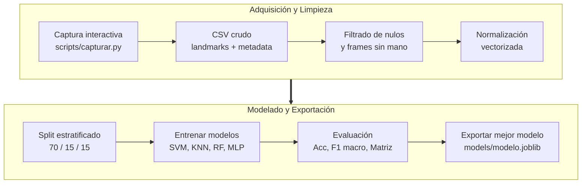
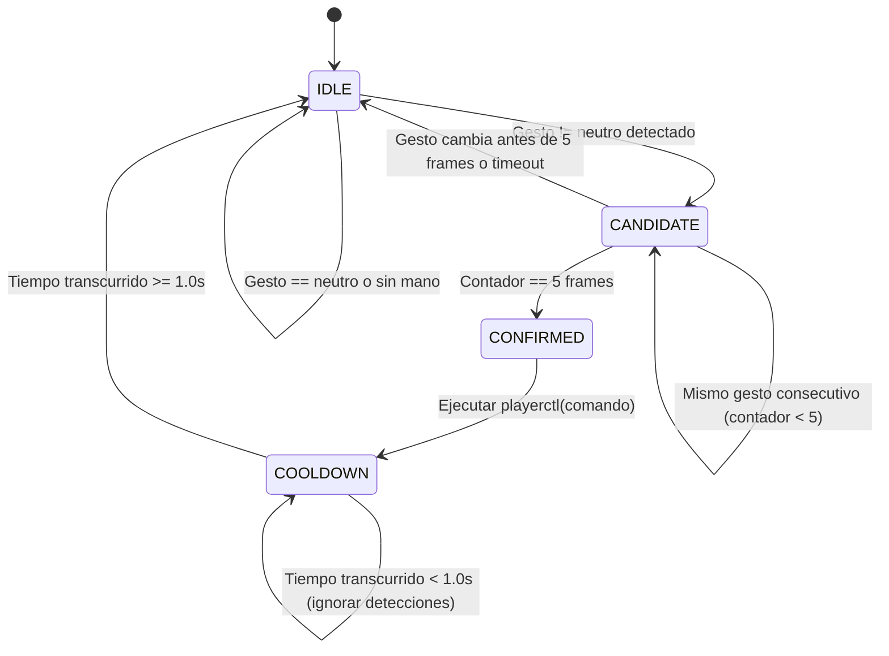

# Documento de Diseño Arquitectónico

## 1. Visión General del Sistema
El sistema se compone de dos subsistemas principales: el **Pipeline de Datos y Entrenamiento** (desarrollo offline) y el **Pipeline de Inferencia en Tiempo Real** (ejecución online acoplada al sistema operativo mediante MPRIS).

---

## 2. Diagramas Arquitectónicos

### 2.1 Pipeline de Inferencia en Tiempo Real

```mermaid
flowchart TB
    subgraph S1 [Captura y Preprocesamiento]
        direction LR
        A[Cel Android / Cámara] -->|scrcpy / ADB / V4L2| B[OpenCV en PC]
        B --> C[MediaPipe Hands<br/>21 landmarks 3D]
        C --> D[Normalización<br/>muñeca + escala + flip]
    end
    subgraph S2 [Inferencia y Control]
        direction LR
        E[Clasificador ML<br/>modelo.joblib] --> F[Filtro de Disparo<br/>5 frames + cooldown]
        F --> G[Despachador Multimedia<br/>Linux: playerctl / Windows: Win32]
        G --> H[Spotify (Linux / Win)]
    end
    S1 ==>|vector 63 features| S2
```

### 2.2 Pipeline de Datos y Entrenamiento



### 2.3 Máquina de Estados del Filtro de Disparo



---

## 3. Esquema de Datos del CSV

El archivo de datos (`data/dataset.csv`) mantiene un esquema estricto de 67 columnas:

| Columna | Tipo | Descripción |
| :--- | :--- | :--- |
| `x0` .. `x20` | `float32` | Coordenadas $x$ normalizadas de los 21 landmarks. |
| `y0` .. `y20` | `float32` | Coordenadas $y$ normalizadas de los 21 landmarks. |
| `z0` .. `z20` | `float32` | Coordenadas de profundidad relativa $z$ normalizadas. |
| `label` | `string` | Etiqueta de clase (`palma`, `senalar`, `paz`, `pulgar`, `puno`, `neutro`). |
| `handedness` | `string` | Mano detectada por MediaPipe (`Right` o `Left`). |
| `session_id` | `string` | Identificador único de sesión de captura (`UUID` o timestamp de sesión). |
| `timestamp` | `float64` | Marca de tiempo POSIX en milisegundos. |

*Nota:* Las 63 primeras columnas (`x0` a `z20`) constituyen la matriz de características $X$, mientras que `label` representa el vector objetivo $y$.

---

## 4. Algoritmo de Normalización Geométrica (`normalizar()`)

Para garantizar que el clasificador aprenda la **forma intrínseca** del gesto y no su ubicación en la pantalla ni el tamaño aparente de la mano frente al lente, se aplica la siguiente transformación determinista sobre la matriz $P \in \mathbb{R}^{21 \times 3}$:

1. **Traslación al origen (Invarianza de posición):**
   Se toma el punto de referencia de la muñeca (landmark 0, $P_0 = (x_0, y_0, z_0)$) y se resta a todos los 21 puntos:
   $$P_i' = P_i - P_0, \quad \forall i \in \{0, 1, \dots, 20\}$$
   *(El landmark 0 resultante siempre tendrá coordenadas $(0, 0, 0)$).*

2. **Escalamiento métrico (Invarianza de distancia/profundidad):**
   Se calcula la distancia euclidiana tridimensional entre la muñeca (punto 0) y el nudillo del dedo medio (landmark 9, Metacarpophalangeal Joint):
   $$d = \|P_9'\|_2 = \sqrt{(x_9')^2 + (y_9')^2 + (z_9')^2}$$
   Si $d > \epsilon$ (con $\epsilon = 10^{-6}$ para prevenir división por cero), se divide cada vector de coordenadas entre la escala $d$:
   $$P_i'' = \frac{P_i'}{d}, \quad \forall i \in \{0, 1, \dots, 20\}$$

3. **Espejado horizontal (Invarianza de lateralidad / Mano dominante):**
   Si la mano etiquetada por MediaPipe es izquierda (`handedness == "Left"`), se invierte el signo del componente $x$ para que ambos lados del cuerpo compartan el mismo espacio euclidiano de representación:
   $$x_i''' = -x_i'', \quad y_i''' = y_i'', \quad z_i''' = z_i''$$

4. **Vectorización:**
   Se aplana la matriz $P''' \in \mathbb{R}^{21 \times 3}$ en un vector unidimensional $V \in \mathbb{R}^{63}$ ordenado como $(x_0, \dots, x_{20}, y_0, \dots, y_{20}, z_0, \dots, z_{20})$.

---

## 5. Estructura Modular y Responsabilidades

```text
scripts/
├── __init__.py
├── utils.py          # Lógica pura: normalizar(), validadores y despachador multimedia multiplataforma.
├── capturar.py       # Interfaz gráfica con OpenCV para captura guiada de dataset en CSV.
└── demo.py           # Inferencia en tiempo real, máquina de estados y despacho a playerctl.

tests/
├── test_normalizar.py # Tests unitarios de invariancia de traslación, escala y simetría.
└── test_filtro.py     # Tests de máquina de estados de 5 frames, cooldown y clase neutro.
```

---

## 6. Riesgos Técnicos y Mitigaciones

| Riesgo Técnico | Impacto | Estrategia de Mitigación |
| :--- | :--- | :--- |
| **API MediaPipe (Legacy Solutions vs Tasks)** | La API moderna `mediapipe.tasks.vision` requiere modelos `.task` descargables y tiene mayor fricción de configuración que la clásica `mp.solutions.hands`. | Se utiliza la interfaz probada `mediapipe.solutions.hands` compatible con CPU y Python 3.10+, empaquetando un fallback modular en `scripts/utils.py`. |
| **Integración de Cámara con `scrcpy` / Android** | Versiones antiguas de Android o configuraciones USB específicas pueden fallar al enviar stream de cámara web virtual. | Priorizar `scrcpy --video-source=camera --no-audio --v4l2-sink=/dev/videoX` o conexión directa OpenCV; si no está disponible, fallback automático a cámara web USB/integrada (`cv2.VideoCapture(0)`). |
| **Confusión entre gestos "paz" y "señalar"** | Ambos gestos comparten el índice extendido y pueden superponerse en proyecciones 2D si el dedo medio no se detecta con nitidez. | La normalización 3D preserva la coordenada $z$, y el cálculo de la distancia relativa entre landmark 12 (punta medio) y landmark 9 (nudillo medio) aporta una separación clara para SVM y Random Forest. |
| **Lag o caída de FPS en CPU ThinkPad T480** | Si OpenCV procesa video a resolución completa (1080p), la CPU colapsará por encima de los 100 ms por cuadro. | Reducir el cuadro de entrada para MediaPipe a resolución 640×480 o 320×240 píxeles, operando con `model_complexity=1` y `static_image_mode=False`. |
