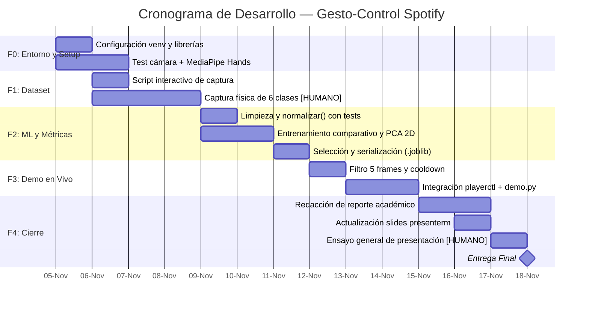

# Plan de Proyecto y Calendario de Entregas

> **Constante de Entrega:**
> `FECHA_ENTREGA = 2026-11-18`  *(Variable centralizada: modificar únicamente este valor si cambia el calendario).*
> `FECHA_INICIO  = 2026-11-05`

---

## 1. Cronograma por Fases

| Fase | Periodo | Hito Principal | Entregables Clave |
| :--- | :--- | :--- | :--- |
| **F0: Entorno y Verificación de Hardware** | 05 nov – 06 nov | Cámara y MediaPipe operativos | `.venv`, `requirements.txt`, script de prueba de cámara. |
| **F1: Adquisición del Dataset Propio** | 06 nov – 08 nov | Dataset completo y validado | `scripts/capturar.py`, `data/dataset.csv` con $\ge 300$ cuadros por clase. |
| **F2: Procesamiento, Modelado y Evaluación** | 09 nov – 11 nov | Mejor modelo entrenado y guardado | `notebooks/analisis.ipynb`, métricas comparativas, `models/modelo.joblib`. |
| **F3: Prototipo en Vivo e Integración MPRIS** | 12 nov – 14 nov | Control funcional de Spotify | `scripts/demo.py`, filtro temporal estabilizado, pruebas con `playerctl`. |
| **F4: Documentación, Presentación y Ensayo** | 15 nov – 17 nov | Material de entrega completado | `reporte/reporte.pdf` o Markdown, `docs/propuesta.md` actualizado, ensayo. |
| **Buffer y Entrega** | 18 nov | Cierre y presentación final | Repositorio congelado y presentación académica. |

---

## 2. Diagrama de Gantt

---

## 3. Gestión de Riesgos del Calendario y Plan B

### 3.1 Agotamiento de Cuota o Fallos del Agente de IA
- **Principio Spec-Driven:** Toda la arquitectura, diseño de datos y tareas están documentados en archivos estándar de Markdown en `specs/`. Ningún contexto crítico reside en el historial del chat.
- **Plan B:** Si una herramienta agéntica (`agy`, Gemini CLI, etc.) agota sus cuotas de uso o falla, el repositorio puede ser continuado inmediatamente por cualquier otro modelo o agente (Claude, OpenAI, Cursor, o trabajo manual por el desarrollador) leyendo `AGENTS.md` y `specs/tasks.md`.

### 3.2 Independencia de Tareas Humanas
- Las tareas marcadas explícitamente como `[HUMANO]` en el backlog (e.g., posar físicamente frente a la cámara en diferentes condiciones de iluminación y ensayar la oratoria) no dependen del agente y pueden avanzar de manera autónoma sin bloqueo tecnológico.

### 3.3 Margen de Seguridad (Buffer)
- El periodo del 17 al 18 de noviembre está reservado con 24 a 36 horas de amortiguador para atender cualquier imprevisto de hardware (e.g. latencia de scrcpy o ajustes finos del cooldown).
